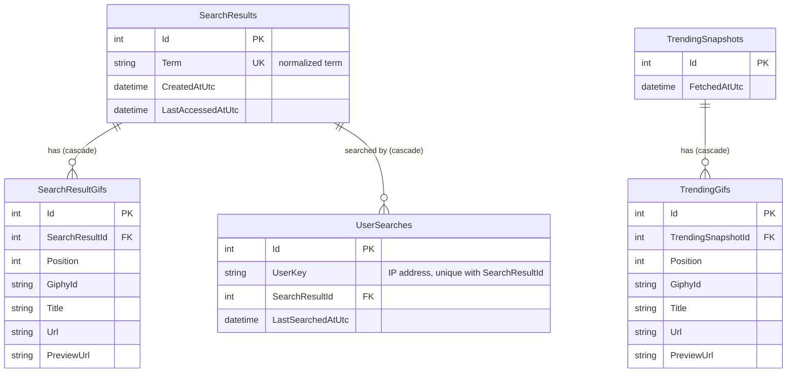

# Giphy Integration

A .NET 10 Web API that fetches GIF URLs from the [Giphy API](https://developers.giphy.com/), plus an Angular client that displays them. The API can:
- return the **trending GIFs of the day**;
- **search** GIFs by term.

Every Giphy request is billed, so both are cached and the app calls Giphy only when it has to.

**Contents:** [Getting started](#getting-started) · [Known limitations and possible improvements](#known-limitations-and-possible-improvements) · [API](#api) · [Configuration](#configuration-appsettingsjson) · [Architecture](#architecture) · [Caching design](#caching-design) · [Database](#database) · [Frontend](#frontend-angular-client)

## Getting started

**Prerequisites:**
- The [.NET 10 SDK](https://dotnet.microsoft.com/download/dotnet/10.0). There is no database to install: the SQLite database is created on first run.
- For the client, [Node.js](https://nodejs.org/) 20.19+, 22.12+ or 24+.

> [!IMPORTANT]
> The API needs a Giphy API key, kept out of source control. Set it once with user secrets (step 1), or with the `Giphy__ApiKey` environment variable. Without a key, the API refuses to start and says why.

```bash
# 1. Store the Giphy API key
dotnet user-secrets set "Giphy:ApiKey" "<your-key>" --project src/GiphyIntegration.Api

# 2. Run the API
dotnet run --project src/GiphyIntegration.Api

# 3. In another terminal, run the client
cd client
npm ci
npm start
```

| Open | URL |
|---|---|
| **The app** | [http://localhost:4200](http://localhost:4200) |
| API documentation (Swagger) | [http://localhost:5006/swagger](http://localhost:5006/swagger) |

**Run the tests:**

```bash
dotnet test                   # API, from the repository root
npm test -- --watch=false     # client, from client/
```

## Known limitations and possible improvements

> [!NOTE]
> The assignment asks for an exam-level solution, not a production-ready one. These are the known limitations and how to address them. Each one is also marked with an `Improvement:` comment in the code.

| Area | Today | How to improve |
|---|---|---|
| **Data growth** | Every query on a request's path uses an index, so lookups stay fast as tables grow. But users are never forgotten, so the search tables grow without limit. | Expire searches not repeated for about 30 days (index on `LastSearchedAtUtc`). The purge job then removes their results as usual. |
| | The purge job re-checks every old result on each run, holding SQLite's write lock. | Flag results as orphaned when their last user drops them, and purge only those, in batches. |
| | Every cache hit is also a database write, and SQLite allows one writer at a time. | Skip the "last used" write if it happened recently. At scale, add an in-memory cache and move to SQL Server or PostgreSQL. |
| **Several instances** | Locks and the trending worker only coordinate within one process. | A distributed lock (Redis), leader election for the trending refresh, and a shared Redis cache. |
| **User identity** | Users are identified by IP address, so people behind one network address share a list. | Authenticated users (one new `ICurrentUser` implementation). Behind a reverse proxy, forwarded headers from trusted proxies only. Store a keyed hash of the IP (GDPR). |
| **Cost protection** | No rate limiting and no circuit breaker. | Per-IP rate limiting and a circuit breaker on the Giphy client. Automatic retries are deliberately left out, since every call is billed. |
| **Bandwidth** | `GET /api/gifs/searches` returns up to 250 GIFs, and the client calls it after every search. | `ETag` / `304 Not Modified`. |
| **Features** | No pagination. Trending is served stale indefinitely if refreshes keep failing. Terms are shown in lower case. | Pagination (Giphy `offset`) with infinite scroll, a maximum staleness for trending, and keeping the user's original casing. |
| **Operations** | Migrations run at startup. No health checks and no end-to-end tests. | An EF Core migration bundle (`dotnet ef migrations bundle`) in the deployment pipeline, health checks, API integration tests (`WebApplicationFactory` with a fake `IGifSource`) and client end-to-end tests (Playwright). |

## API

| Capability | Endpoint |
|---|---|
| Trending GIFs of the day | `GET /api/gifs/trending` |
| Search GIFs by term | `GET /api/gifs/search?q={term}` |
| The caller's cached searches, with their GIFs, for the frontend's own cache | `GET /api/gifs/searches` |

All endpoints return JSON. Errors use [RFC 9457 problem details](https://www.rfc-editor.org/rfc/rfc9457).

| Status | When |
|---|---|
| `400` | Invalid search term (blank or longer than 50 characters) |
| `502` | Giphy unreachable or failing |

`GET /api/gifs/search?q=Funny%20Cats` returns:

```json
{
  "query": "funny cats",
  "fromCache": false,
  "count": 25,
  "gifs": [
    { "id": "abc", "title": "Funny cat", "url": "https://media.giphy.com/.../giphy.gif", "previewUrl": "https://media.giphy.com/.../200.gif" }
  ]
}
```

- `url` is the original GIF. `previewUrl` is a lighter rendition suited for grids.
- `fromCache` tells whether Giphy was called. The trending endpoint returns the same shape, with `query: null`.

`GET /api/gifs/searches` returns:

```json
{
  "maxEntries": 10,
  "searches": [
    { "term": "funny cats", "lastSearchedAtUtc": "2026-10-23T12:03:54.88Z", "gifs": [ ... ] }
  ]
}
```

## Configuration (`appsettings.json`)

| Setting | Default | Meaning |
|---|---|---|
| `Giphy:ApiKey` | — | **Required.** Set it through user secrets or an environment variable, never in the file. |
| `Giphy:Limit` / `Rating` / `Language` | `25` / `g` / `en` | Giphy query parameters |
| `Trending:RefreshInterval` | `01:00:00` | How often the worker refreshes trending GIFs |
| `SearchCache:MaxSearchesPerUser` | `10` | Searches kept per user. Caching saves calls, but too many cached options hurts UX. |
| `SearchCache:PurgeInterval` | `00:10:00` | How often unreferenced search results are purged |
| `SearchCache:UnreferencedRetention` | `00:10:00` | Grace period before an unreferenced result is purged |
| `Cors:AllowedOrigins` | `http://localhost:4200` | Origins allowed to call the API (the Angular dev server) |
| `ConnectionStrings:GifCache` | `Data Source=gifcache.db` | SQLite file, relative to the API project |

The API fails fast at startup with a clear message if any setting is missing or invalid.

## Architecture

```
src/
  GiphyIntegration.Core            Domain models, abstractions and caching services. No infrastructure dependency.
  GiphyIntegration.Infrastructure  Giphy HTTP client, EF Core persistence, background jobs, DI registration
  GiphyIntegration.Api             Controllers, user identification, error handling, composition root
tests/
  GiphyIntegration.Tests           Unit tests, plus persistence tests on in-memory SQLite built from the real migrations
client/                            Angular 21 frontend (see "Frontend" below)
```

Dependencies point inwards: Api → Infrastructure → Core. Core owns every interface (dependency inversion), so the upstream provider, the storage or the way users are identified can each be swapped without touching the caching logic.

| Pattern / principle | Where |
|---|---|
| Strategy / dependency inversion | `IGifSource`: Giphy today, any provider tomorrow |
| | `ICurrentUser`: IP today, authenticated user tomorrow |
| Repository | `ISearchResultCache`, `IUserSearchHistory` and `ITrendingGifStore`, implemented with EF Core |
| Template Method | `PeriodicBackgroundService` owns scheduling, scoping and error handling. `TrendingRefreshWorker` and `SearchCachePurgeWorker` only supply the work. |
| | `GifRecordConfiguration<T>` maps the columns shared by both GIF tables. |
| Value Object | `SearchTerm` normalizes and validates terms, so `"  Funny CATS"` and `"funny cats"` share one cache entry. |
| Options pattern | Strongly typed settings, validated at startup |
| Single responsibility | Shared search results and per-user history are separate abstractions. |

## Caching design

### Trending: memory, then database, then Giphy
- Requests are served from an **in-memory snapshot**. It is immutable and swapped atomically, so reads are lock-free.
- The snapshot is also **stored in the database**, so a restart doesn't cost a Giphy call.
- `TrendingRefreshWorker` **restores the stored snapshot at startup**. It fetches a new one only if the stored one is missing or older than the refresh interval. After that it **refreshes every hour**.
- Each refresh **replaces the previous snapshot**, in memory and in the database. The database write is a single transaction: insert the new snapshot, delete the old one, and cascade-delete its GIFs.
- If Giphy fails, the last good snapshot keeps being served.
- The endpoint calls Giphy itself only when neither memory nor the database holds anything.

### Search: results shared, cache scoped per user
- A user is identified by **IP address**, since there is no account system.
- Each user keeps their **last N searches** (default 10, LRU). Searching a term again moves it back to the top.
- **GIF results are stored once per term and shared across users.** When Bob searches "cats" after Alice did, Giphy isn't called again.
- When a search drops out of a user's list, its result stays as long as another user references it. `SearchCachePurgeWorker` removes results nobody references anymore, off the request path.

### Concurrency
- **Single flight per key.** On a cache miss the service takes a per-key async lock and checks the cache again before calling Giphy (double-checked locking). Concurrent requests for the same new term make **one** paid call; different terms run in parallel.
  - The lock (`StripedAsyncLock`) stripes keys over a fixed set of semaphores, so its memory is bounded and nothing needs cleaning up.
- **Single-statement database writes:**
  - Cache hits update a "last accessed" timestamp and eviction runs as one delete (EF Core `ExecuteUpdate`/`ExecuteDelete`).
  - Unique constraints catch races between instances: for example, the same term cached twice is ignored safely.
- **Touch, then read:** a cache hit first refreshes `LastAccessedAtUtc`, and only then reads the GIFs. The purge job only deletes results not accessed recently, so it can never remove a result while it is being read.
- **Paid responses are always kept:** they are persisted even if the client disconnects mid-request.
- SQLite runs in **WAL mode**, so reads proceed while a write is in progress.

## Database

| Table | Purpose |
|---|---|
| `SearchResults` / `SearchResultGifs` | One shared result per normalized term, with its GIFs in Giphy's order |
| `UserSearches` | Links each user (IP) to their most recent searches |
| `TrendingSnapshots` / `TrendingGifs` | The latest trending snapshot only |



- The schema is defined by the EF Core model, and its migrations are the only source of truth. The initial migration is in [src/GiphyIntegration.Infrastructure/Persistence/Migrations](src/GiphyIntegration.Infrastructure/Persistence/Migrations).
- Migrations are applied automatically at startup. To work with them by hand, use the EF Core CLI. It is pinned as a local tool in `dotnet-tools.json`.

```bash
dotnet tool restore
dotnet ef migrations add <Name> -p src/GiphyIntegration.Infrastructure -s src/GiphyIntegration.Api -o Persistence/Migrations
dotnet ef database update -p src/GiphyIntegration.Infrastructure -s src/GiphyIntegration.Api
```

## Frontend (Angular client)

A minimal Angular 21 app in [client/](client): standalone components, signals, zoneless change detection, no UI library. It supports light and dark themes and works on mobile.

**What it shows:**
- A search bar.
- Chips for **Trending** and for the user's **cached searches**, with a count such as "3 / 10 recent searches cached".
- A responsive grid of GIFs. The grid uses `previewUrl`, and clicking a GIF opens the original `url`.
- A badge saying where the GIFs came from: *From your browser cache*, *From the server cache* or *Fresh from Giphy*. This makes each caching layer visible.

**Client-side cache of the searches:**
- On load, the client calls `GET /api/gifs/searches` and keeps the user's cached searches, with their GIFs, in a signal-based store (`GifStore`). The store is mirrored to `sessionStorage`, so after a reload the chips appear before the API answers.
- Opening a cached search shows its GIFs **instantly from the browser cache**, then refreshes them from the API. This is a cache hit on the server, so it costs no Giphy call, and it also moves the search to the top of the user's list on the server.
- After every search, the client calls `GET /api/gifs/searches` again. **The server stays the source of truth**, and the client trims its own copy with the server's `maxEntries`.
- Search terms are normalized like on the server (trimmed, single spaces, lower case), so both sides use the same cache key.
- If the user switches view before a response arrives, the outdated request is cancelled (`switchMap`), so an old result never overwrites the current one.

| Folder | Content |
|---|---|
| `core/api` | `GifApi` HTTP client, base URL token, problem-details → message mapping |
| `core/state` | `GifStore`: view state, browser cache, sync with the API |
| `core/storage` | `sessionStorage` persistence (failure tolerant) |
| `core/search` | Search term normalization, mirroring the API |
| `features/*` | `SearchBar`, `RecentSearches` and `GifGrid` presentational components |

The API URL is set in `client/src/environments/`. Locally the client calls the API directly, which the API's CORS policy allows for `http://localhost:4200`.
